<div align="center">

<a href="https://sideways-drift-club.vercel.app/">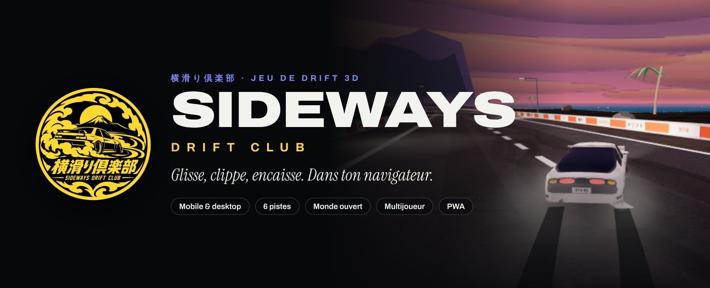</a>

<br>

<a href="https://sideways-drift-club.vercel.app/"></a>
&nbsp;
<a href="#-installer-sur-mobile"></a>
&nbsp;
<a href="#-lancer-en-local">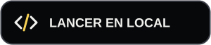</a>

<br><br>


**Jeu de drift mobile en 3D, jouable dans le navigateur.** Inspiration FR Legends.<br>
Lance la voiture, tiens l'angle, clippe les murs, encaisse le combo.<br>
Aucune installation, aucun compte, aucune pub. Tout reste sur ton appareil.

</div>

---

## 🏁 Le jeu en images

<table>
  <tr>
    <td colspan="2">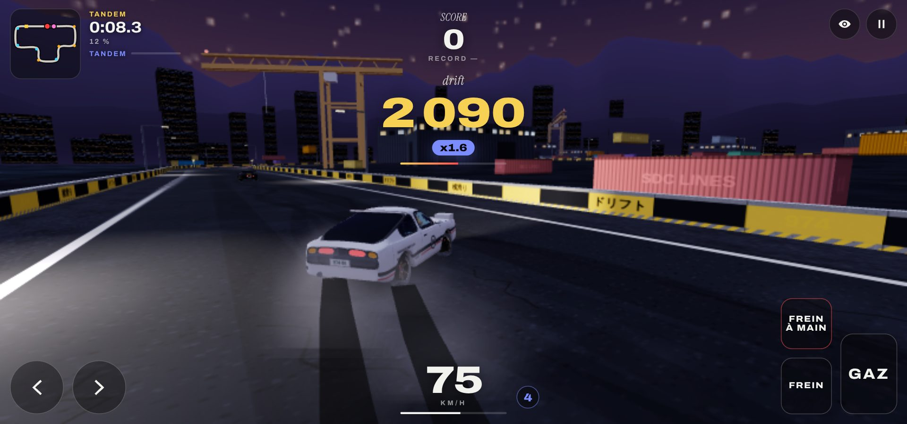</td>
  </tr>
  <tr>
    <td width="50%">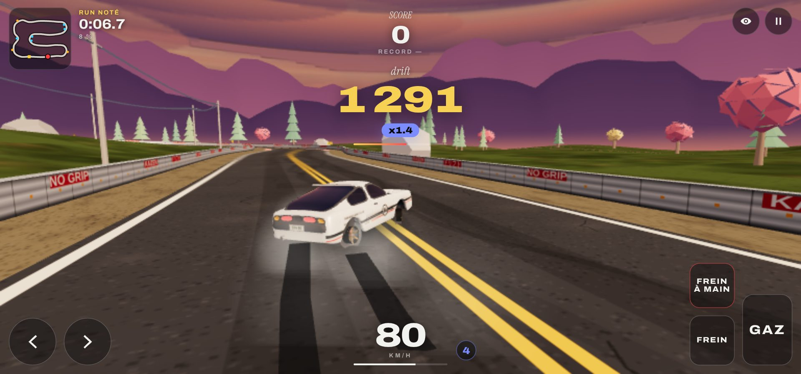</td>
    <td width="50%">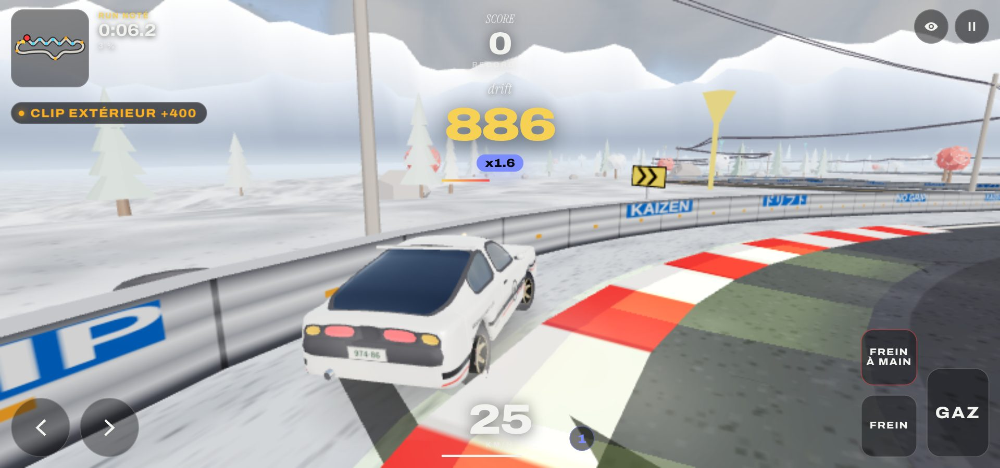</td>
  </tr>
  <tr>
    <td>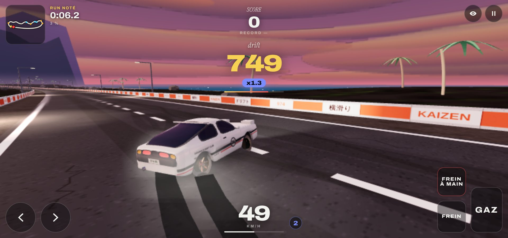</td>
    <td>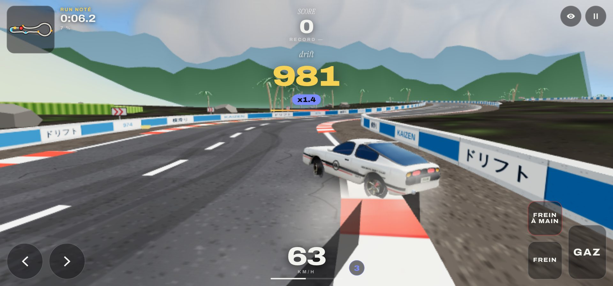</td>
  </tr>
  <tr>
    <td>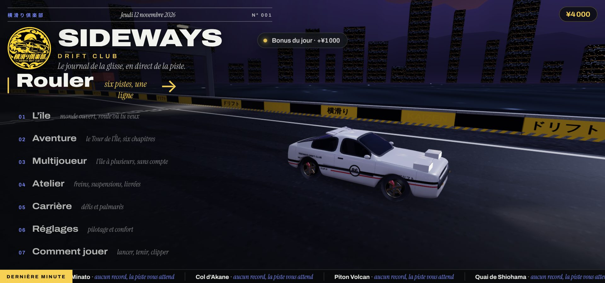</td>
    <td>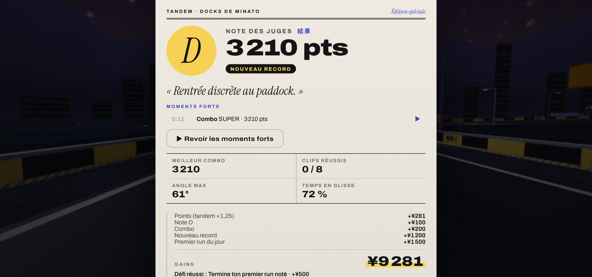</td>
  </tr>
  <tr>
    <td>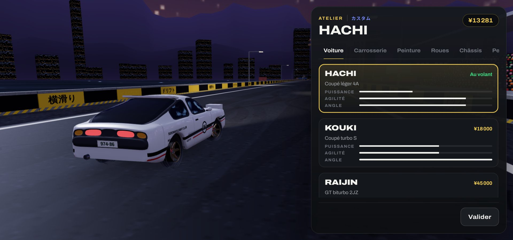</td>
    <td>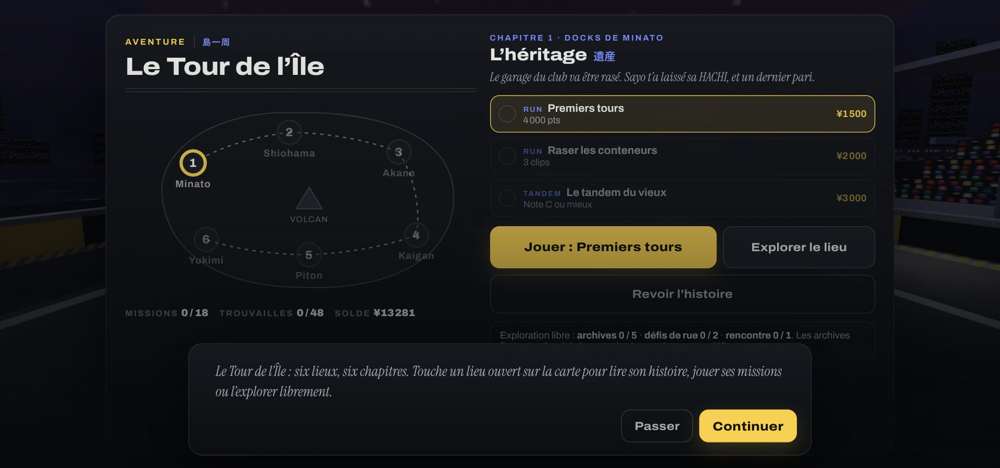</td>
  </tr>
</table>

## ✨ Ce qu'il y a dedans

| | |
|---|---|
| 🛣️ **6 pistes** | Docks de Minato (nuit), Col d'Akane (coucher de soleil), Piton Volcan (jour), Quai de Shiohama (aube), Col de Yukimi (neige, adhérence ×0,88), Corniche de Kaigan (crépuscule). |
| 🏝️ **L'île, monde ouvert** | 2,1 × 1,5 km, 15 routes, 10 carrefours, 9 km de bitume, relief jusqu'à 110 m. Circulation (5 modèles, roulage à gauche), 4 pilotes rivaux à défier (touge, tandem de rue), 6 habitants à qui parler, radars, zones de glisse, belvédères photo, 12 daruma dorés, carte et GPS. |
| 👥 **Multijoueur** | Jusqu'à 4 pilotes sur l'île, pair à pair (WebRTC), sans compte ni serveur de jeu : invitation par code ou lien, messages rapides, course et battle de drift lancées par l'hôte. Voitures distantes lissées (30 envois par seconde, retard adapté à la qualité du réseau). |
| 📖 **Aventure** | « Le Tour de l'Île » : 6 chapitres × 3 missions, 7 personnages, archives à collectionner, défis de rue. |
| 🎯 **3 modes** | Run noté (note de S à D), Tandem (chasse le leader), Libre (entraînement). En run noté, ton **fantôme** (meilleur run de la piste) roule en transparence et le HUD affiche l'écart de points en direct. |
| 🔧 **Atelier** | 3 voitures, carrosserie, 12 peintures × 5 finitions, 6 livrées, 5 jantes, fumée colorée, 6 pièces de perf × 3 niveaux, réglages freins et suspension. |
| 🎬 **Moments forts** | En fin de run, les 3 meilleurs instants (gros combo, clip, frôlé, angle record) ; replay cinématique (poursuite, travelling, bord de piste, ralenti sur les clips et les frôlés). Les 8 derniers enregistrements des pistes se revoient depuis la Carrière. |
| 💴 **Carrière** | Yens fictifs (aucun achat réel), 36 défis, bonus quotidien, records par piste. |
| 📱 **Tactile d'abord** | Boutons déplaçables et redimensionnables, miroir gauche/droite, clavier et manette aussi. |
| ⚡ **Fluide sur petit Android** | Physique à 120 Hz interpolée, résolution dynamique, 64–67 appels de dessin par image, deux niveaux de détail par voiture. |

## 🎮 Commandes

| Action | Tactile | Clavier |
|---|---|---|
| Gaz / frein | `GAZ` / `FREIN` | ↑ ↓ ou Z S / W S |
| Braquer | ‹ › | ← → ou Q D / A D |
| Frein à main (lancer la glisse) | `FREIN À MAIN` | Espace |
| Vue (caméra) | 👁 | C |
| Se replacer | menu pause | R |
| Interagir (île) | bouton contextuel en bas | E |
| Carte et GPS (île) | menu pause | M |
| Klaxon · messages rapides (session) | 📯 👋 GG ➜ 🔥 | H · 1 à 4 |

Manette compatible. **Le geste de base :** prends de la vitesse, braque, tire le frein à main un court instant, puis tiens les gaz.

---

## 🧰 Stack technique

<table>
<tr><td>

**Moteur et rendu**
- **Three.js r128** (cdnjs) : scène, `InstancedMesh`, shaders précompilés
- Carrosseries, ailerons et rétroviseurs **modélisés dans Blender par script** (surface de subdivision, arêtes biseautées, occlusion ambiante par sommet, 2 niveaux de détail) ; décors et ciels procéduraux
- Peinture vernie (clearcoat), reflets par cubemap peinte texel par texel
- Résolution dynamique et paliers de qualité auto

</td><td>

**Simulation**
- Modèle bicyclette, pneus saturés, assistance d'angle
- Pas fixe **120 Hz** + interpolation d'affichage
- Fiche « tunée » : chaque réglage écrit en écart au neutre
- Leader tandem sur trajectoire précalculée

</td></tr>
<tr><td>

**Son et interface**
- **Web Audio API** : moteur, turbo et crissement synthétisés, zéro fichier audio
- HTML/CSS vanilla, polices **Archivo**, **Instrument Serif**, **Noto Sans JP** (Google Fonts)
- PWA : manifeste, icônes, plein écran paysage

</td><td>

**Qualité et livraison**
- Tests `node:test` (133) : économie, physique, tracés, île, vie de l'île, multijoueur, fluidité réseau, modèles 3D, aventure
- **24 tests de bout en bout** (`e2e/`) : parcours joueur complets dans un vrai navigateur, en CI
- ESLint (tout nom utilisé est importé), Prettier, CI GitHub Actions
- Bancs d'essai **Playwright** : fumée de bout en bout, bot pilote, perf, CPU ralenti
- Build : **esbuild** suit les imports depuis `src/main.js` et produit **un seul `index.html`**
- Hébergement **Vercel**, déployé depuis `main`

</td></tr>
</table>

**Zéro dépendance à l'exécution.** Pas de framework. esbuild (build) et Blender (modèles) ne servent qu'en développement : le navigateur ne charge que `index.html` et Three.js.

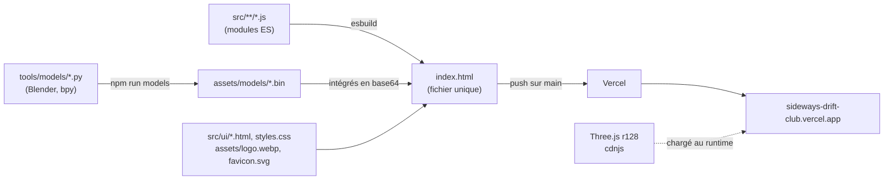

### Outils utilisés

| Outil | Usage |
|---|---|
| Node.js ≥ 20 | Build (`build.mjs`, esbuild) et tests (`node --test`) |
| Blender 5 (`pip install bpy`) | Carrosseries : `tools/models/build_cars.py` → `assets/models/*.bin` |
| ESLint, Prettier | Garde-fou d'imports, mise en forme |
| Playwright + Chromium | Captures, bot expert, mesures de perf et d'audio (`tools/`) |
| Vercel | Hébergement statique, déploiement à chaque merge sur `main` |
| Claude (Anthropic) | Conception et code assistés par IA (mention dans l'écran d'aide) |
| Outils d'IA générative | Logo et visuels |

---

## 📱 Installer sur mobile

Le jeu est une **PWA** : il s'installe comme une appli, en plein écran, sans store.

| Appareil | Étapes |
|---|---|
| **Android** (Chrome) | Ouvre [le jeu](https://sideways-drift-club.vercel.app/) → menu ⋮ → **Installer l'application** (ou *Ajouter à l'écran d'accueil*). |
| **iPhone / iPad** (Safari) | Ouvre [le jeu](https://sideways-drift-club.vercel.app/) → bouton **Partager** → **Sur l'écran d'accueil**. |
| **Ordinateur** (Chrome, Edge) | Icône d'installation dans la barre d'adresse, ou joue directement dans l'onglet. |

**Mise à jour côté joueur :** rien à faire. Le jeu n'a pas de cache hors ligne (pas de service worker) : chaque ouverture charge la dernière version. Ta progression (`localStorage`) est conservée.

## 💻 Lancer en local

```bash
git clone https://github.com/shanlihenriderussy-rgb/Sideways-Drift-Club.git
cd Sideways-Drift-Club
npm install                    # esbuild, ESLint, Prettier (développement seulement)
npm run build                  # régénère index.html
npx serve .                    # ou : python3 -m http.server 8000
```

Ouvre `http://localhost:3000` (ou `:8000`). Un simple double-clic sur `index.html` fonctionne aussi.

**Hors ligne (tests, captures) :**

```bash
mkdir -p vendor
curl -o vendor/three.min.js https://cdnjs.cloudflare.com/ajax/libs/three.js/r128/three.min.js
npm run build:local            # test.html, Three.js depuis vendor/
npm test                       # 133 tests
npm run smoke                  # fumée de bout en bout (Playwright) : run, atelier, île, multijoueur
npm run e2e                    # 24 parcours joueur de bout en bout (≈ 5 min en rendu logiciel)
```

## 🔄 Mettre à jour le jeu

1. **Récupérer** la dernière version : `git checkout main && git pull`.
2. **Coder** dans `src/` (jamais dans `index.html`, il est généré).
3. **Vérifier** :
   ```bash
   npm run check                 # lint + tests + build : tout doit passer
   npm run smoke                 # le jeu démarre, un run se joue, deux onglets se voient en multijoueur
   npm run e2e                   # parcours joueur complets : accueil, premier run, run noté, atelier, île, multijoueur
   ```
   Nouveau tracé → `tests/tracks.test.js` impose : pas de recoupement, ≥ 5 virages, 900–1 900 m, un seul type de clip par virage.
4. **Committer** `src/` **et** `index.html` ensemble (conventional commits : `feat(piste): …`, `fix(atelier): …`). La CI refuse un `index.html` qui n'est pas à jour.
5. **Ouvrir une PR** vers `main`. Au merge, Vercel redéploie en ligne en ~1 min.
6. **Retoucher une voiture** : les lignes de caisse sont dans `tools/models/cars.py`.
   ```bash
   pip install bpy                                         # Blender en module Python
   python3 tools/models/build_cars.py kouki --preview out/ # une voiture + rendus Cycles de contrôle
   python3 tools/models/build_cars.py --blend out/         # les .blend, pour une retouche à la main
   python3 tools/models/build_cars.py kouki --preview out/ --show wing_swan,mirror_aero   # choisir les pièces montrées
   npm run models && npm test                              # les trois voitures, puis tests/models.test.js
   ```
7. **Rafraîchir les visuels** de cette page si l'interface a changé :
   ```bash
   npm run build:local
   node tools/readme-shots.mjs   # docs/screenshots/*.jpg (bot au volant)
   node tools/readme-banner.mjs  # docs/brand/banner.jpg
   ```

## 🎨 Kit de marque

<table>
<tr>
<td align="center">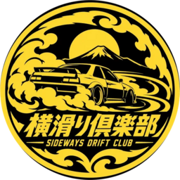<br><sub>Emblème</sub><br><sub><a href="docs/brand/logo-512.png">512</a> · <a href="docs/brand/logo-256.png">256</a> · <a href="docs/brand/logo-128.png">128</a> px</sub></td>
<td align="center">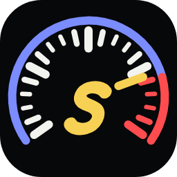<br><sub>Icône d'appli</sub><br><sub><a href="docs/brand/icon-tachy-256.png">PNG 256</a> · <a href="assets/favicon.svg">SVG</a></sub></td>
<td>

| Rôle | Couleur |
|---|---|
| Action, argent, combo |  |
| Rubriques, tandem |  |
| Alertes |  |
| Fond |  |

Direction : « Télémétrie de nuit ». La 3D est le sujet, l'interface s'efface.

</td>
</tr>
</table>

---

<details>
<summary><b>📂 Structure du code</b></summary>

Modules ES, imports explicites. `src/main.js` initialise les modules du jeu dans l'ordre ; tout ce qui est « pur » (sans DOM ni Three.js) est testé sous Node.

| Dossier | Rôle |
|---|---|
| `src/sim/` | **Simulation pure** : `physics.js` (modèle bicyclette, pneus saturés, assistance d'angle), `track.js` (6 tracés, virages, clips), `leader.js` (ligne de drift et leader tandem), `ghost.js` (fantôme du record), `replay.js` (moments forts) |
| `src/progress/` | **Progression pure** : `economy.js` (portefeuille, atelier, gains, défis, fiche tunée), `story.js` (aventure : 6 chapitres × 3 missions) |
| `src/net/` | **Multijoueur** : `state.js` (état compact), `sanitize.js` (filtrage de tout ce qui vient du réseau), `session.js` (étoile, l'hôte relaie), `interp.js` (lissage des voitures distantes), `invite.js` (codes d'invitation), `links.js` (WebRTC, lien local entre onglets) |
| `src/island/` | **L'île** : `map.js` (réseau routier, terrain ; pur), `life.js` (GPS, circulation, rivaux, activités ; pur), `scenery.js` et `actors.js` (rendu) |
| `src/render/` | **Rendu** : `world.js` (ciel, décors par thème), `fx.js` (fumée, gomme, étincelles), `geometry.js` (outils), `car/` : `format.js` (lecture des modèles, pur), `index.js` (caisse + pièces de l'atelier), `livery.js` (livrée peinte), `wheels.js` |
| `src/game/` | **Le jeu** : `state.js` (état partagé), `stage.js` (rendu, qualité), `scene.js` (piste, voitures, reflets), `loop.js` (pas fixe 120 Hz), `camera.js`, `score.js`, `collide.js`, `hud.js`, `input.js`, `touch.js`, `session.js`, `menus.js`, `adventure.js`, `multiplayer.js`, `moments.js`, `island/` (monde, vie, interactions, épreuves, carte), `boot.js` |
| `src/ui/` | `page.html` (gabarit), `styles.css`, `markup.html`, `shop.js` (atelier) |
| `src/audio/` | `sound.js` : moteur, turbo, crissement synthétisés (Web Audio) |
| `assets/models/` | Carrosseries exportées de Blender (`*.bin` : demi-modèle, 2 niveaux de détail, lignes de caisse) |
| `tools/models/` | Générateur Blender : `carlib.py` (cage, vitrages, joints, optiques, occlusion, export), `cars.py` (fiches de style), `parts.py` (ailerons, rétroviseurs), `build_cars.py` |
| `.claude/skills/impeccable/` | Skill de design d'interface [Impeccable](https://github.com/pbakaus/impeccable) (Apache 2.0) : `/impeccable critique`, `polish`, `audit`… pour le travail sur l'UI avec Claude Code |
| `tools/` | `smoke.mjs` (fumée de bout en bout), `bench-physics.mjs`, `bench-perf.mjs`, `bot-run.mjs`, `shots-cars.mjs`, visuels du README ; `lib/harness.mjs` (Playwright, pilote automatique) |
| `tests/` | `npm test` : économie, physique, tracés, île, vie de l'île, multijoueur, fluidité réseau, modèles 3D, fantôme, moments forts, aventure |
| `e2e/` | `npm run e2e` : tests de bout en bout (Playwright + `node:test`), un joueur neuf par test. `accueil` (titre, navigation), `premier-run` (aide, choix de session, départ au doigt), `run` (glisse, pause, résultats, gains conservés), `atelier` (aperçu, achat, refus), `ile-multijoueur` (monde ouvert, carte, deux joueurs) |
| `build.mjs` | esbuild + assemblage du fichier unique (`index.html`, ou `test.html` hors ligne) |

</details>

<details>
<summary><b>💴 Économie et atelier</b></summary>

- Monnaie fictive (¥), sans achat réel. Départ : HACHI offerte + ¥3 000. KOUKI ¥18 000, RAIJIN ¥45 000.
- Gains : 7 % des points (×1,25 en tandem), bonus de note (¥100 à ¥2 500), ¥100 par clip, combo, record, prime de ¥1 500 au premier run noté du jour ; mode libre : 3 % plafonné à ¥3 500. Bonus quotidien de ¥1 000 à ¥4 000 selon la série. 36 défis à récompense unique (paliers faciles, assiduité, exploits, une note A par piste).
- Atelier : carrosserie (pare-chocs, ailes, aileron, capot, échappement, arceau, néon), peinture (12 couleurs, 5 finitions, 6 livrées, numéro), roues (5 jantes, 8 couleurs, fumée colorée), performances (6 pièces × 3 niveaux, dont kit de freins visible sur les roues), réglages gratuits avec fiche technique en direct.
- Réglages : freins (puissance, répartition avant/arrière, frein à main), suspension (raideur avant, raideur arrière, amortisseurs, hauteur, carrossage), style (déport). Valeur neutre = physique d'origine ; aux extrêmes : arrêt ±20 %, équilibre sous-vireur ↔ survireur, sans tête-à-queue au banc.

</details>

<details>
<summary><b>📖 Aventure : « Le Tour de l'Île »</b></summary>

- Le garage du club, aux docks de Minato, va être rasé par Kaneshiro Holdings. Le règlement du port le protège si le club gagne le Tour de l'Île. Six chapitres, un par lieu, dans l'ordre du Tour : Minato, Shiohama, Akane, Kaigan, Piton, Yukimi.
- Personnages : Kenji (mécano, un secret de 2006), Lou (reporter du Journal de la glisse), Mika (cheffe des Kuro Kumo), Ryo Kaneshiro (promoteur), Mamie Zélie (gardienne du volcan), Daruma (juge masqué), Sayo (fondatrice, par sa lettre).
- Missions : run ou tandem avec objectifs (score, note, clips, angle, combo, % en glisse, aucun contact mur). Récompense payée à la première réussite. Le chapitre suivant s'ouvre quand le précédent est fini.
- Exploration libre de chaque lieu ouvert : 5 archives (l'histoire du club, à relire dans le carnet), 2 bornes de défi de rue, 1 rencontre. Progression dans `sdc:profile.story`.

</details>

<details>
<summary><b>🏝️ L'île : monde ouvert</b></summary>

- Menu → « L'île » : une île continue d'environ 2,1 × 1,5 km, 15 routes et 10 carrefours (9 km), relief jusqu'à 110 m au volcan, mer tout autour, régions (port, côte, montagne, volcan, neige).
- Conduite libre partout, y compris hors route (l'herbe freine). En mer, la voiture est replacée sur la route la plus proche.
- **Interagir** : un bouton apparaît en bas quand quelque chose est à portée (E au clavier). La voiture s'arrête le temps du dialogue.
- **Portes** : les six lieux de l'aventure ; entrer ouvre la carte de l'aventure sur ce chapitre (« Retour » remet sur la route).
- **Circulation** : 16 à 22 voitures (kei, berline, fourgon, kei-truck, bus) qui roulent à gauche, ralentissent dans les virages, s'arrêtent derrière un obstacle, klaxonnent puis dépassent. Les accrocher coûte le combo.
- **Rivaux** : Nana (dès le début), Kai (chapitre 2), Tetsu (chapitre 4), Mika (chapitre 5). Ils sillonnent l'île en glisse ; approche-toi, ils se rangent et t'attendent. Défis : touge (premier arrivé à un lieu à 0,7–1,8 km) ou tandem de rue (rester à moins de 15 m pendant 45 s, 50 % du temps). Prime pleine à la première victoire, un cinquième ensuite.
- **Habitants** : Kenji, Lou, Zélie, Ume, Sora, Hoshi. Chacun a quelque chose à dire et propose de régler le GPS (prochaine étape de l'aventure, daruma le plus proche, rival, défi à tenter).
- **Frôlé !** : passer en glisse à moins d'un mètre d'une voiture de la circulation sans la toucher : +300 × multiplicateur, une fois par voiture et par passage.
- **Activités** : 3 radars (vitesse) et 4 zones de glisse (points entre deux arches), 3 étoiles chacune, payées une fois. 4 belvédères : arrête-toi dans le cercle bleu et prends la photo.
- **Carte et GPS** : carte complète (lieux, rivaux en direct, activités et étoiles, habitants, belvédères, daruma) ; toucher un repère règle le GPS (flèche, distance par la route, tracé sur la mini-carte).
- 12 daruma dorés à trouver (¥500 chacun). Fin de balade : gains du mode libre et bilan de l'île. Progression dans `sdc:profile.isle`.

</details>

<details>
<summary><b>👥 Multijoueur</b></summary>

- Menu → « Multijoueur » : un hôte crée la session, invite jusqu'à 3 pilotes. Pas de compte, pas de serveur de jeu : l'hôte envoie un **code ou un lien d'invitation** (copier, ou partager), l'invité colle l'invitation et renvoie un **code de réponse**, l'hôte le valide. Ouvrir le lien d'invitation ouvre directement l'écran pour rejoindre.
- Réseau : **même Wi-Fi** (par défaut, aucun serveur tiers) ou **Internet** (serveur STUN public, qui voit l'adresse IP).
- Sur l'île : voitures des autres avec pseudo et combo en cours, contacts, messages rapides (klaxon, salut, GG, suis-moi qui règle ton GPS sur l'autre joueur, en feu). L'hôte lance une **course** (grille de départ derrière lui, premier arrivé à un lieu) ou une **battle de drift** de 90 s. Gagnant : ¥800.
- Technique : topologie en étoile (l'hôte relaie), deux canaux (état non fiable à 30 Hz en roulant et 4 Hz à l'arrêt, évènements fiables), tout message reçu est filtré (taille, types, bornes, pseudo nettoyé, voiture validée). La circulation et les rivaux sont propres à chaque appareil.
- Fluidité (`src/net/interp.js`, `tests/interp.test.js`) : trajectoire en courbe de Hermite (la vitesse reçue sert de tangente), retard d'affichage adapté à la gigue mesurée (70 ms sur un réseau propre, jusqu'à 400 ms), horloge de lecture sans saut, extrapolation le long de l'arc quand un paquet tarde, écart résorbé en 120 ms à la reprise. Mesuré en simulation : avec 40 ms de gigue et 10 % de pertes, aucun recul et moins de 3 cm d'écart à la trajectoire. **Non mesuré sur de vrais téléphones.**

</details>

<details>
<summary><b>📱 Commandes tactiles (détail)</b></summary>

Réglages → *Personnaliser* : déplacer chaque bouton, taille générale + taille par bouton, transparence, miroir, réinitialisation. Disposition enregistrée par orientation (`localStorage`, clé `sdc:touchLayout`). Un doigt peut glisser d'un bouton à l'autre sans lâcher (hit-test + hystérésis de 28 px). Zoom : bloqué sur la surface de jeu (`touch-action: none`, garde `touchend`, `gesture*`), autorisé dans les menus (`pan-y pinch-zoom`) ; le viewport ne l'interdit pas (WCAG 1.4.4).

</details>

<details>
<summary><b>📊 Mesures de référence (2026-11-12, rendu logiciel)</b></summary>

- Appels de dessin : 64–67 par image en tandem (inchangé). Script : 0,5–0,8 ms/image.
- Triangles par image en tandem : 86–104 k (qualité basse), 122–153 k (moyenne), 159–200 k (haute). Les carrosseries Blender comptent ~38 k triangles au niveau fin, ~9,5 k au niveau léger.
- Poids de `index.html` : 1,7 Mo (0,47 Mo avant les modèles 3D ; les trois carrosseries pèsent ~0,96 Mo en binaire).
- Banc physique (`tools/bench-physics.mjs`) : chiffres identiques à la version précédente.
- **Non mesuré ici** : images par seconde et temps de chargement sur un vrai téléphone (l'environnement de développement n'a pas de carte graphique).

</details>

## 🔒 Données et transparence

- **Hors multijoueur, aucune donnée personnelle ne quitte l'appareil.** Réglages, records et profil de jeu (`sdc:profile` : solde, voitures, pièces, défis, 40 derniers mouvements) restent en `localStorage` sur l'appareil du joueur.
- **Multijoueur (à l'initiative du joueur) :** pseudo, voiture et position sont envoyés aux seuls joueurs de la session, le temps de la session, sans stockage en ligne. La connexion est directe : chaque joueur voit l'adresse IP des autres. Mode « même Wi-Fi » par défaut, sans serveur tiers ; le mode « Internet » utilise un serveur STUN public de Google (hors UE), qui voit l'adresse IP. L'écran l'explique avant toute connexion et conseille un pseudo qui n'est pas le vrai nom. Analyse à faire valider par le DPO / conseil avant une diffusion large.
- **Contenu assisté par IA :** jeu conçu et codé avec l'assistance d'une IA (Claude), carrosseries générées par script dans Blender ; logo et visuels créés avec des outils d'IA. Mention affichée dans l'écran d'aide du jeu.
- Monnaie du jeu fictive, sans achat réel.

<div align="center">
<br>
<a href="https://sideways-drift-club.vercel.app/"></a>
<br><br>
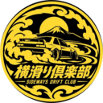<br>
<sub>横滑り倶楽部 · Sideways Drift Club</sub>
</div>
