<div align="center">

<a href="https://sideways-drift-club.vercel.app/">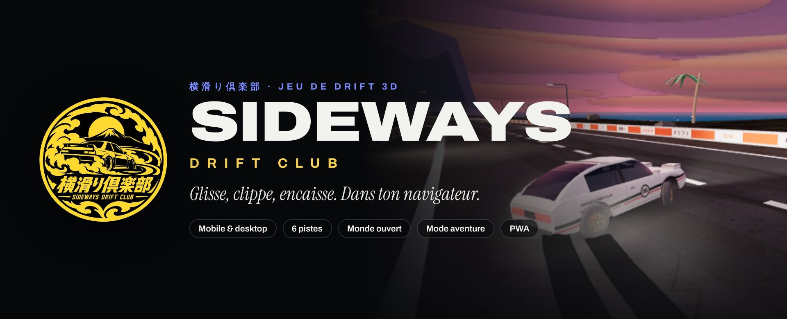</a>

<br>

<a href="https://sideways-drift-club.vercel.app/"></a>
&nbsp;
<a href="#-installer-sur-mobile"></a>
&nbsp;
<a href="#-lancer-en-local"></a>

<br><br>


**Jeu de drift mobile en 3D, jouable dans le navigateur.** Inspiration FR Legends.<br>
Lance la voiture, tiens l'angle, clippe les murs, encaisse le combo.<br>
Aucune installation, aucun compte, aucune pub. Tout reste sur ton appareil.

</div>

---

## 🏁 Le jeu en images

<table>
  <tr>
    <td colspan="2">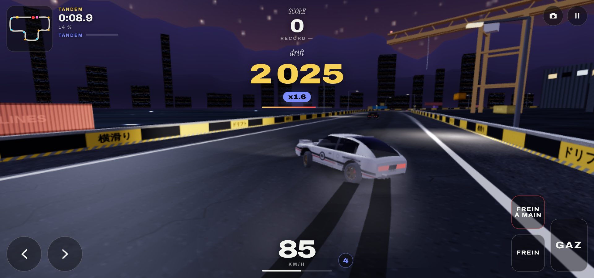</td>
  </tr>
  <tr>
    <td width="50%">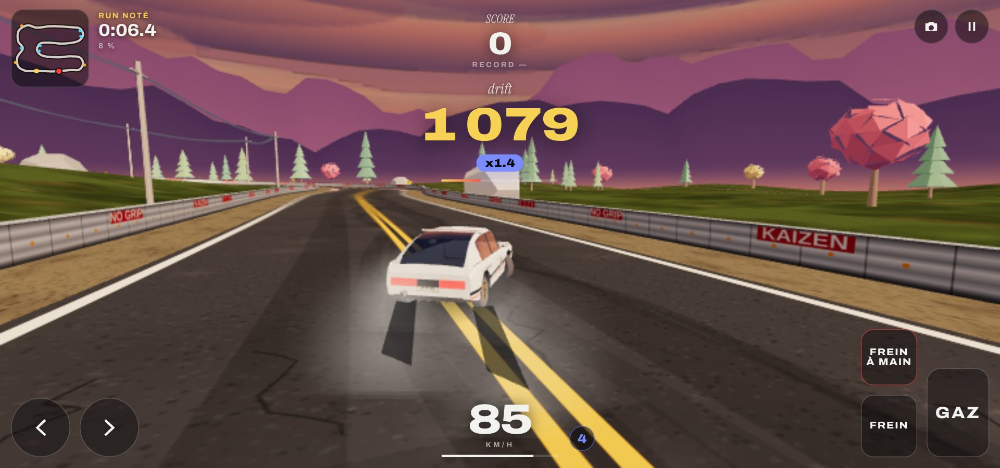</td>
    <td width="50%">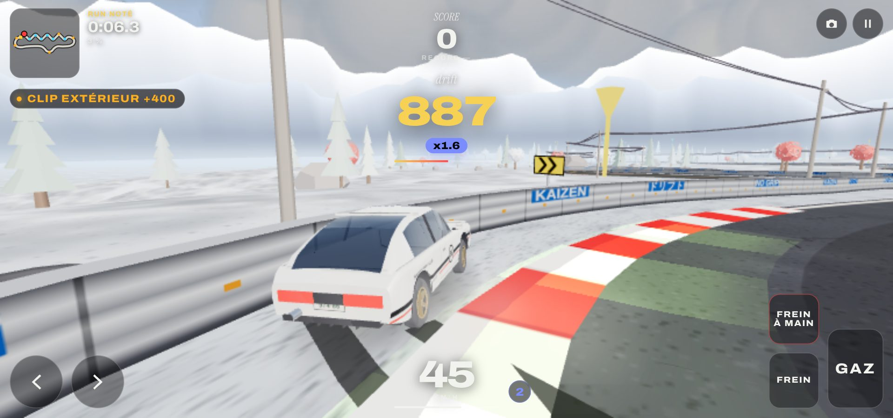</td>
  </tr>
  <tr>
    <td>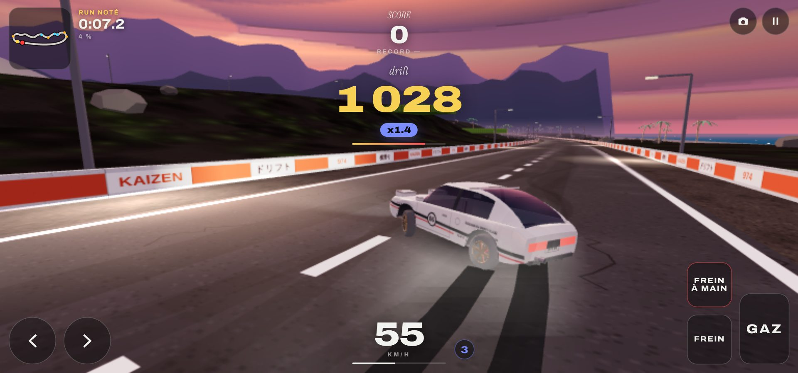</td>
    <td>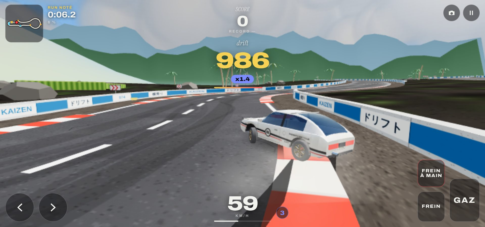</td>
  </tr>
  <tr>
    <td>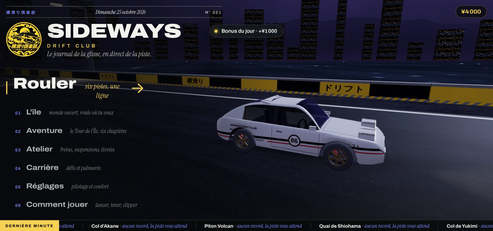</td>
    <td>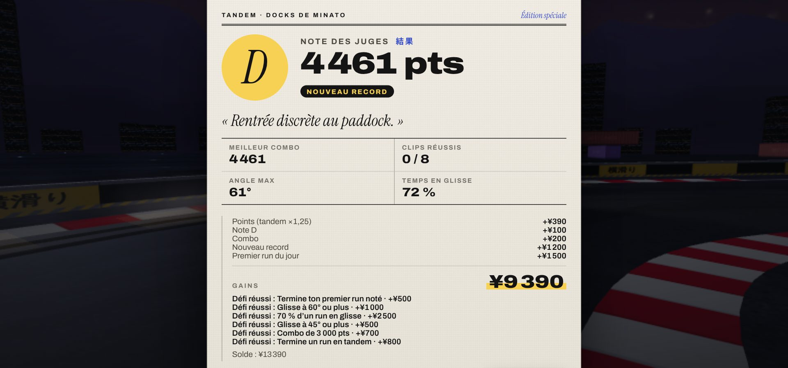</td>
  </tr>
  <tr>
    <td>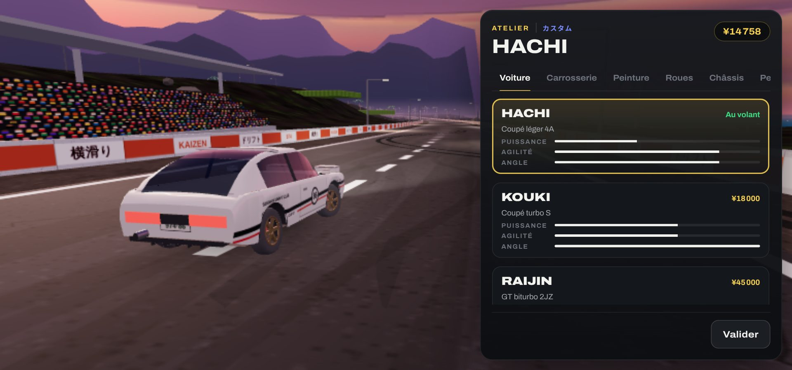</td>
    <td>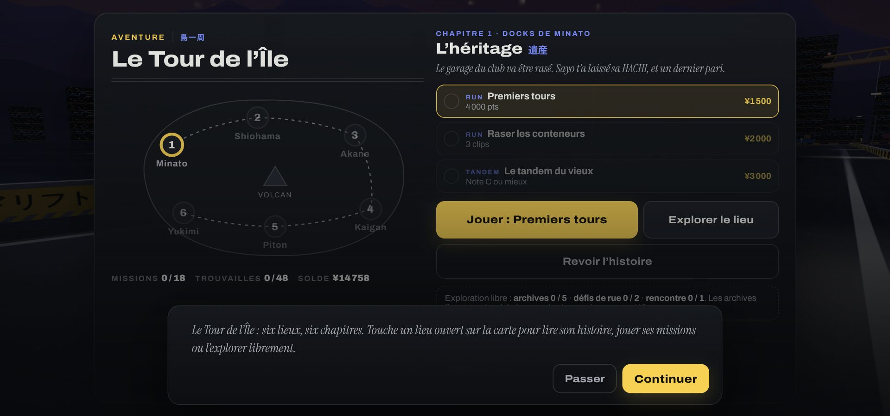</td>
  </tr>
</table>

## ✨ Ce qu'il y a dedans

| | |
|---|---|
| 🛣️ **6 pistes** | Docks de Minato (nuit), Col d'Akane (coucher de soleil), Piton Volcan (jour), Quai de Shiohama (aube), Col de Yukimi (neige, adhérence ×0,88), Corniche de Kaigan (crépuscule). |
| 🏝️ **L'île, monde ouvert** | 2,1 × 1,5 km, 15 routes, 10 carrefours, 9 km de bitume, relief jusqu'à 110 m, 12 daruma dorés à trouver. |
| 📖 **Aventure** | « Le Tour de l'Île » : 6 chapitres × 3 missions, 7 personnages, archives à collectionner, défis de rue. |
| 🎯 **3 modes** | Run noté (note de S à D), Tandem (chasse le leader), Libre (entraînement). |
| 🔧 **Atelier** | 3 voitures, carrosserie, 12 peintures × 5 finitions, 6 livrées, 5 jantes, fumée colorée, 6 pièces de perf × 3 niveaux, réglages freins et suspension. |
| 💴 **Carrière** | Yens fictifs (aucun achat réel), 36 défis, bonus quotidien, records par piste. |
| 📱 **Tactile d'abord** | Boutons déplaçables et redimensionnables, miroir gauche/droite, clavier et manette aussi. |
| ⚡ **Fluide sur petit Android** | Physique à 120 Hz interpolée, résolution dynamique, 65–68 appels de dessin par image. |

## 🎮 Commandes

| Action | Tactile | Clavier |
|---|---|---|
| Gaz / frein | `GAZ` / `FREIN` | ↑ ↓ ou Z S / W S |
| Braquer | ‹ › | ← → ou Q D / A D |
| Frein à main (lancer la glisse) | `FREIN À MAIN` | Espace |
| Caméra | 📷 | C |
| Se replacer | menu pause | R |

Manette compatible. **Le geste de base :** prends de la vitesse, braque, tire le frein à main un court instant, puis tiens les gaz.

---

## 🧰 Stack technique

<table>
<tr><td>

**Moteur et rendu**
- **Three.js r128** (cdnjs) : scène, `InstancedMesh`, shaders précompilés
- Voitures, décors et ciels **100 % procéduraux** (aucun modèle 3D importé)
- Reflets par cubemap peinte sur canvas, pas de PMREM
- Résolution dynamique et paliers de qualité auto

</td><td>

**Simulation**
- Modèle bicyclette, pneus saturés, assistance d'angle
- Pas fixe **120 Hz** + interpolation d'affichage
- Fiche « tunée » : chaque réglage écrit en écart au neutre
- Leader tandem sur trajectoire précalculée

</td></tr>
<tr><td>

**Son et interface**
- **Web Audio API** : moteur, turbo et crissement synthétisés, zéro fichier audio
- HTML/CSS vanilla, polices **Archivo**, **Instrument Serif**, **Noto Sans JP** (Google Fonts)
- PWA : manifeste, icônes, plein écran paysage

</td><td>

**Qualité et livraison**
- Tests `node:test` (80) : économie, physique, tracés, île, aventure
- Bancs d'essai **Playwright** : bot pilote, perf, CPU ralenti ×6, audio
- Build : `build.mjs` assemble `src/*` en **un seul `index.html`**
- Hébergement **Vercel**, déployé depuis `main`

</td></tr>
</table>

**Zéro dépendance npm en production.** Pas de framework, pas de bundler : un script Node concatène les sources, le navigateur fait le reste.

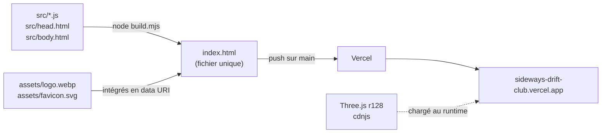

### Outils utilisés

| Outil | Usage |
|---|---|
| Node.js ≥ 18 | Build (`build.mjs`) et tests (`node --test`) |
| Playwright + Chromium | Captures, bot expert, mesures de perf et d'audio (`tools/`) |
| Vercel | Hébergement statique, déploiement à chaque merge sur `main` |
| Claude (Anthropic) | Conception et code assistés par IA (mention dans l'écran d'aide) |
| Outils d'IA générative | Logo et visuels |

---

## 📱 Installer sur mobile

Le jeu est une **PWA** : il s'installe comme une appli, en plein écran, sans store.

| Appareil | Étapes |
|---|---|
| **Android** (Chrome) | Ouvre [le jeu](https://sideways-drift-club.vercel.app/) → menu ⋮ → **Installer l'application** (ou *Ajouter à l'écran d'accueil*). |
| **iPhone / iPad** (Safari) | Ouvre [le jeu](https://sideways-drift-club.vercel.app/) → bouton **Partager** → **Sur l'écran d'accueil**. |
| **Ordinateur** (Chrome, Edge) | Icône d'installation dans la barre d'adresse, ou joue directement dans l'onglet. |

**Mise à jour côté joueur :** rien à faire. Le jeu n'a pas de cache hors ligne (pas de service worker) : chaque ouverture charge la dernière version. Ta progression (`localStorage`) est conservée.

## 💻 Lancer en local

```bash
git clone https://github.com/shanlihenriderussy-rgb/Sideways-Drift-Club.git
cd Sideways-Drift-Club
node build.mjs                 # régénère index.html
npx serve .                    # ou : python3 -m http.server 8000
```

Ouvre `http://localhost:3000` (ou `:8000`). Un simple double-clic sur `index.html` fonctionne aussi.

**Hors ligne (tests, captures) :**

```bash
mkdir -p vendor
curl -o vendor/three.min.js https://cdnjs.cloudflare.com/ajax/libs/three.js/r128/three.min.js
node build.mjs --local         # test.html, Three.js depuis vendor/
node --test tests/*.test.js    # 80 tests
```

## 🔄 Mettre à jour le jeu

1. **Récupérer** la dernière version : `git checkout main && git pull`.
2. **Coder** dans `src/` (jamais dans `index.html`, il est généré).
3. **Vérifier** :
   ```bash
   node --test tests/*.test.js   # tout doit passer
   node build.mjs                # régénère index.html
   ```
   Nouveau tracé → `tests/tracks.test.js` impose : pas de recoupement, ≥ 5 virages, 900–1 900 m, un seul type de clip par virage.
4. **Committer** `src/` **et** `index.html` ensemble (conventional commits : `feat(piste): …`, `fix(atelier): …`).
5. **Ouvrir une PR** vers `main`. Au merge, Vercel redéploie en ligne en ~1 min.
6. **Rafraîchir les visuels** de cette page si l'interface a changé :
   ```bash
   node build.mjs --local
   node tools/readme-shots.js    # docs/screenshots/*.jpg (bot au volant)
   node tools/readme-banner.js   # docs/brand/banner.jpg
   ```

## 🎨 Kit de marque

<table>
<tr>
<td align="center">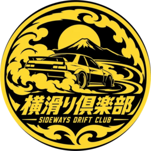<br><sub>Emblème</sub><br><sub><a href="docs/brand/logo-512.png">512</a> · <a href="docs/brand/logo-256.png">256</a> · <a href="docs/brand/logo-128.png">128</a> px</sub></td>
<td align="center">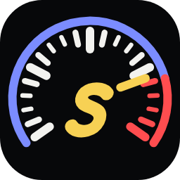<br><sub>Icône d'appli</sub><br><sub><a href="docs/brand/icon-tachy-256.png">PNG 256</a> · <a href="assets/favicon.svg">SVG</a></sub></td>
<td>

| Rôle | Couleur |
|---|---|
| Action, argent, combo |  |
| Rubriques, tandem |  |
| Alertes |  |
| Fond |  |

Direction : « Télémétrie de nuit ». La 3D est le sujet, l'interface s'efface.

</td>
</tr>
</table>

---

<details>
<summary><b>📂 Structure du code</b></summary>

| Fichier | Rôle |
|---|---|
| `src/physics.js` | Modèle bicyclette, pneus saturés, régulateur d'angle de drift (assistance) ; lit les champs de fiche tunée (`steerRate`, `driftSteer`, `angleBoost`, `rollK`, `brakeK`, `brakeRear`, `hbK`, `latBal`, `damp`, `camber`) et l'adhérence de piste (`grip`) |
| `src/economy.js` | Portefeuille en yens, catalogue de l'atelier, gains de fin de run, défis, bonus quotidien, fiche tunée. Logique pure, testée |
| `src/track.js` | 6 tracés, échantillonnage, virages et clips (un type par virage, règle des tracés officiels), barème (`par`), adhérence (`grip`, neige) |
| `src/world.js` | Ciel (nuages, étoiles), crêtes, route et murs par lieu, décor instancié par thème, tribune, eau animée. Thèmes `dawn`, `snow`, `dusk` = palettes posées sur une famille de décor (`decor`) |
| `src/car.js` | Voitures procédurales : caisse lissée (loft), habitacle, livrée peinte, pièces modulaires, roues instanciées |
| `src/fx.js` | Fumée colorée (points), traces de gomme (envoi GPU partiel), étincelles |
| `src/audio.js` | Moteur, turbo, crissement synthétisés (Web Audio) |
| `src/ai.js` | Leader tandem sur trajectoire précalculée |
| `src/story.js` | Aventure « Le Tour de l'Île » : 6 chapitres × 3 missions, dialogues, objectifs, exploration (archives, défis de rue, rencontres). Logique pure, testée |
| `src/island.js` | L'île : monde ouvert continu (9 km de routes, carrefours, relief, volcan, mer), recherche de route, terrain (partie pure, testée) et rendu Three.js |
| `src/shop.js` | Atelier : 6 rayons, aperçu avant achat, barre d'achat |
| `src/game.js` | Boucle (pas fixe 120 Hz + interpolation), caméra, score, collisions, entrées, interface, carrière |
| `assets/favicon.svg`, `icons/`, `manifest.webmanifest` | Favicon (intégré au build), icônes d'application, manifeste PWA |
| `docs/` | Visuels de cette page : `screenshots/`, `brand/` (bannière, logos PNG, boutons) |
| `tests/` | `node --test tests/*.test.js` : économie, effets physiques des réglages, tracés, île, aventure |
| `tools/` | Bancs d'essai : physique (Node), captures, tour complet, bot expert, perf, CPU ralenti, analyse audio, visuels du README (Playwright) |

</details>

<details>
<summary><b>💴 Économie et atelier</b></summary>

- Monnaie fictive (¥), sans achat réel. Départ : HACHI offerte + ¥3 000. KOUKI ¥18 000, RAIJIN ¥45 000.
- Gains : 7 % des points (×1,25 en tandem), bonus de note (¥100 à ¥2 500), ¥100 par clip, combo, record, prime de ¥1 500 au premier run noté du jour ; mode libre : 3 % plafonné à ¥3 500. Bonus quotidien de ¥1 000 à ¥4 000 selon la série. 36 défis à récompense unique (paliers faciles, assiduité, exploits, une note A par piste).
- Atelier : carrosserie (pare-chocs, ailes, aileron, capot, échappement, arceau, néon), peinture (12 couleurs, 5 finitions, 6 livrées, numéro), roues (5 jantes, 8 couleurs, fumée colorée), performances (6 pièces × 3 niveaux, dont kit de freins visible sur les roues), réglages gratuits avec fiche technique en direct.
- Réglages : freins (puissance, répartition avant/arrière, frein à main), suspension (raideur avant, raideur arrière, amortisseurs, hauteur, carrossage), style (déport). Valeur neutre = physique d'origine ; aux extrêmes : arrêt ±20 %, équilibre sous-vireur ↔ survireur, sans tête-à-queue au banc.

</details>

<details>
<summary><b>📖 Aventure : « Le Tour de l'Île »</b></summary>

- Le garage du club, aux docks de Minato, va être rasé par Kaneshiro Holdings. Le règlement du port le protège si le club gagne le Tour de l'Île. Six chapitres, un par lieu, dans l'ordre du Tour : Minato, Shiohama, Akane, Kaigan, Piton, Yukimi.
- Personnages : Kenji (mécano, un secret de 2006), Lou (reporter du Journal de la glisse), Mika (cheffe des Kuro Kumo), Ryo Kaneshiro (promoteur), Mamie Zélie (gardienne du volcan), Daruma (juge masqué), Sayo (fondatrice, par sa lettre).
- Missions : run ou tandem avec objectifs (score, note, clips, angle, combo, % en glisse, aucun contact mur). Récompense payée à la première réussite. Le chapitre suivant s'ouvre quand le précédent est fini.
- Exploration libre de chaque lieu ouvert : 5 archives (l'histoire du club, à relire dans le carnet), 2 bornes de défi de rue, 1 rencontre. Progression dans `sdc:profile.story`.

</details>

<details>
<summary><b>🏝️ L'île : monde ouvert</b></summary>

- Menu → « L'île » : une île continue d'environ 2,1 × 1,5 km, 15 routes et 10 carrefours (9 km), relief jusqu'à 110 m au volcan, mer tout autour, régions (port, côte, montagne, volcan, neige).
- Conduite libre partout, y compris hors route (l'herbe freine). En mer, la voiture est replacée sur la route la plus proche.
- Les six lieux de l'aventure sont des portes jaunes sur l'île : en franchir une ouvre la carte de l'aventure sur ce chapitre (« Retour » remet sur la route).
- 12 daruma dorés à trouver (¥500 chacun), mini-carte de l'île entière. Fin de balade : gains du mode libre.

</details>

<details>
<summary><b>📱 Commandes tactiles (détail)</b></summary>

Réglages → *Personnaliser* : déplacer chaque bouton, taille générale + taille par bouton, transparence, miroir, réinitialisation. Disposition enregistrée par orientation (`localStorage`, clé `sdc:touchLayout`). Un doigt peut glisser d'un bouton à l'autre sans lâcher (hit-test + hystérésis de 28 px). Zoom : bloqué sur la surface de jeu (`touch-action: none`, garde `touchend`, `gesture*`), autorisé dans les menus (`pan-y pinch-zoom`) ; le viewport ne l'interdit pas (WCAG 1.4.4).

</details>

<details>
<summary><b>📊 Mesures de référence (2026-10-14)</b></summary>

- Appels de dessin : 65–68 par image en tandem. JS : 0,4–0,5 ms/image ; 1,9–2,8 ms avec CPU ralenti ×6.
- Saccade d'affichage (écart image à image du déplacement) : 0,1 % à 60, 90, 120 et 144 Hz (avant : 14 à 60 % au-delà de 60 Hz).
- Chargement d'une piste avec CPU ×6 : 0,38–0,52 s (décor bien plus riche ; hors partie).
- Audio : fondamentale moteur = régime/60×2 ; crissement +12 dB au-dessus du moteur en glisse ; pas de saturation.

</details>

## 🔒 Données et transparence

- **Aucune donnée personnelle.** Réglages, records et profil de jeu (`sdc:profile` : solde, voitures, pièces, défis, 40 derniers mouvements) restent en `localStorage` sur l'appareil du joueur. Rien n'est envoyé.
- **Contenu assisté par IA :** jeu conçu et codé avec l'assistance d'une IA (Claude) ; logo et visuels créés avec des outils d'IA. Mention affichée dans l'écran d'aide du jeu.
- Monnaie du jeu fictive, sans achat réel.

<div align="center">
<br>
<a href="https://sideways-drift-club.vercel.app/"></a>
<br><br>
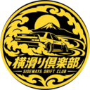<br>
<sub>横滑り倶楽部 · Sideways Drift Club</sub>
</div>
